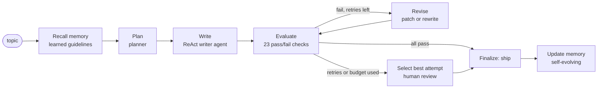
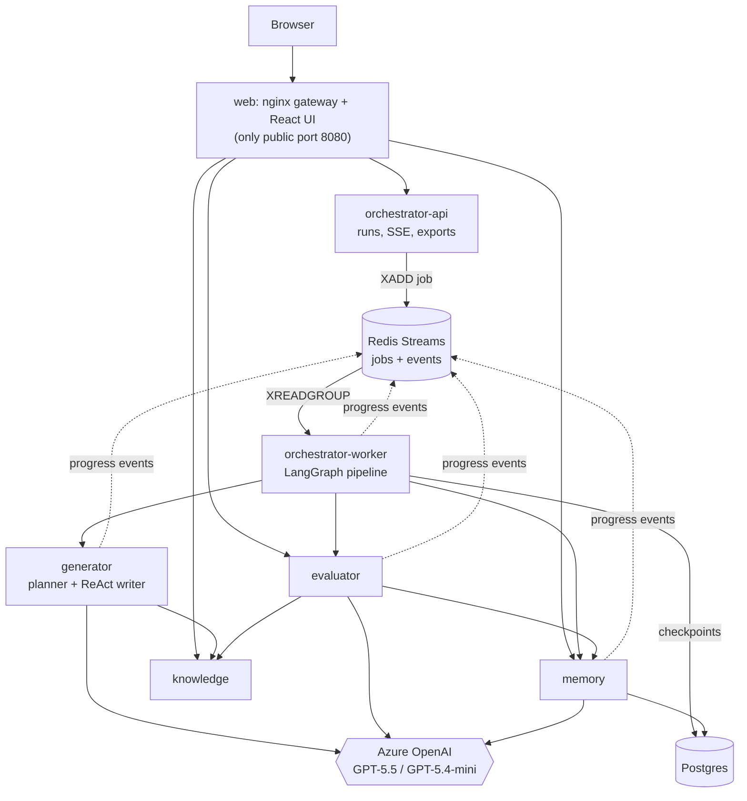

# Self-Evaluating Lesson Generator

An agentic system that **writes a beginner lesson, judges it against a rubric of 23 hard
pass/fail checks, and regenerates it until it is good enough to ship** - before a human ever
sees it. It keeps a persistent memory, learns from its own failures and from human feedback,
and shows every step live in a web UI.

- **Submission topic:** Introduction to RAG (Retrieval-Augmented Generation)
- **Learner:** a 12th-grade graduate in India from a non-English-medium school, with limited
  English vocabulary, who wants to start a career in AI. Lessons use simple English with
  Hindi hints for every key word.
- **Stack:** Python 3.13 · LangGraph 1.2 · LangChain 1.4 · FastAPI · Azure OpenAI
  (GPT-5.5 + GPT-5.4-mini) · Postgres · Redis Streams · React 19 + TypeScript + plain CSS ·
  nginx · Docker Compose (10 containers)

| Deliverable | Where |
|---|---|
| Final lesson | [`docs/final-lesson/introduction-to-rag.md`](docs/final-lesson/) |
| Rejection log of that run | [`docs/final-lesson/rejection-log.md`](docs/final-lesson/) |
| Architecture and design decisions | [`docs/ARCHITECTURE.md`](docs/ARCHITECTURE.md) |
| The rubric, check by check | [`docs/RUBRIC.md`](docs/RUBRIC.md) |
| Loom walkthrough script | [`docs/DEMO_SCRIPT.md`](docs/DEMO_SCRIPT.md) |

---

## How it works in one picture



1. **Recall** - guidelines learned from earlier runs (and unprocessed human notes) are loaded
   from memory and injected into the planner's and writer's prompts.
2. **Plan** - a planner outlines objectives, sections in teaching order, one everyday-Indian
   analogy and one worked example, grounded in the curated knowledge pack.
3. **Write** - a **ReAct agent** researches the knowledge base, looks up approved Hindi
   meanings, self-checks readability with the evaluator's own metrics, and submits a typed
   lesson (structural problems are bounced back to it before evaluation).
4. **Evaluate** - an independent service runs **23 binary checks** in parallel: 9 in plain code,
   11 focused LLM judges (one question each, verbatim evidence verified, FAILs confirmed by a
   second vote), a **ReAct fact-checker** that verifies every claim against the knowledge
   base, and a **simulated learner** that must answer held-out questions from the lesson alone.
5. **Regenerate** - on any failure the reasons, evidence and fix instructions go back to the
   writer (targeted *patch*, or *rewrite* when too much failed). At most **2 retries**, plus a
   cost budget, so the loop always terminates.
6. **Output** - the passing lesson plus a **rejection log** (what failed, why, what changed);
   if it never passes, the best attempt is escalated for human review instead of shipped.
7. **Learn** - memory consolidation turns failures and what fixed them into new or sharpened
   guidelines, tracks whether each guideline actually helps, retires the ones that do not, and
   turns human corrections of the evaluator into rubric proposals that only a human can approve.

## Architecture



| Service | Responsibility |
|---|---|
| `web` | React UI and the API gateway (prefix routing, unbuffered SSE, rate limit on run creation, security headers). The only container with a published port. |
| `orchestrator-api` | Public run API: queue, list, watch live (Server-Sent Events), cancel, resume, export, system status. |
| `orchestrator-worker` | Executes the LangGraph pipeline; checkpoints every step in Postgres; scales horizontally. |
| `generator` | Planner and ReAct writer (create / revise). Internal only. |
| `evaluator` | The rubric engine and the deliberate-error presets used by the Evaluator Lab. |
| `knowledge` | Curated topic packs (sourced notes, glossary with Hindi, key points, held-out questions) and search. |
| `memory` | Long-term memory: runs, attempts (rejection logs), guidelines, feedback, versioned rubric; consolidation. |
| `postgres`, `redis` | Durable state; job queue + replayable event streams. |
| `migrate` | One-shot Alembic migration + rubric v1 seed, gating the memory service. |

Why split it this way - **the author is not the judge** (separate services, prompts and models),
the orchestrator owns control flow only, knowledge is shared ground truth, memory is the single
owner of learning state, and the API/worker split keeps multi-minute LLM runs off the API. The
full reasoning and trade-offs are in [`docs/ARCHITECTURE.md`](docs/ARCHITECTURE.md).

## Quick start

**Prerequisites:** Docker Desktop (Compose v2.24+) and an Azure OpenAI resource with two chat
deployments (a strong one such as GPT-5.5 and a cheaper one such as GPT-5.4-mini).

```bash
git clone https://github.com/Anup2000-git/self-evaluating-lesson-generator.git
cd self-evaluating-lesson-generator
cp .env.example .env          # Windows: copy .env.example .env
# edit .env: AZURE_OPENAI_ENDPOINT, AZURE_OPENAI_API_KEY, AZURE_OPENAI_API_VERSION,
#            LLM_PRIMARY_DEPLOYMENT, LLM_FAST_DEPLOYMENT
docker compose up --build -d
```

Open **http://localhost:8080**.

1. **System** -> *Run LLM check* - verifies chat, structured output and tool calling on both
   deployments.
2. **Studio** -> *Generate lesson* - watch the pipeline, the agents' Thought -> Action ->
   Observation steps and the 23 checks fill in live; export the lesson (.md or *Copy for
   Google Docs*) and the rejection log when it ships.
3. **Evaluator Lab** -> pick *Factual error* (or another preset) -> *Evaluate only* to watch
   the evaluator catch it, or *Evaluate + repair* to watch the loop fix it.
4. **Memory & Learning** - the learning curve, learned guidelines and rubric proposals.

Prefer the terminal? `python scripts/lessongen.py generate --topic "Introduction to RAG"`
streams the same events (standard library only - see [Command line](#command-line)).

Stop with `docker compose down` (add `-v` to also delete the database and event history).

## Configuration

Everything is configured in `.env` (see [`.env.example`](.env.example) for all options).

| Variable | Default | Meaning |
|---|---|---|
| `AZURE_OPENAI_ENDPOINT` / `AZURE_OPENAI_API_KEY` | - | Your Azure OpenAI resource. The key never leaves the backend containers. |
| `AZURE_OPENAI_API_VERSION` | `2025-04-01-preview` | A dated version uses the classic endpoint; `v1` uses the GA `/openai/v1/` API. |
| `LLM_PRIMARY_DEPLOYMENT` | `gpt-5.5` | Strong model: planner, writer, judge tie-breaker, memory reflector. |
| `LLM_FAST_DEPLOYMENT` | `gpt-5.4-mini` | Cheaper model: LLM judges, judge confirmation, fact-checker, simulated learner. |
| `LLM_ROLES__<ROLE>__<FIELD>` | - | Per-role override, e.g. `LLM_ROLES__FACT_CHECKER__TIER=primary`, `LLM_ROLES__WRITER__REASONING_EFFORT=high`. |
| `MAX_RETRIES` | `2` | Retries after the first attempt (the loop stops after at most 3 attempts). |
| `RUN_BUDGET_USD` | `5` | No new retry starts once a run has spent this much. |
| `HELPER_LANGUAGE` | `Hindi` | Language of the word hints. |
| `JUDGE_CONFIRM_FAILS` | `true` | A FAIL needs a second vote; a disputed FAIL goes to a third (strong) model. |
| `AZURE_OPENAI_EMBEDDING_DEPLOYMENT` | empty | Optional: enables hybrid (BM25 + embeddings) search in the knowledge service. |
| `LANGSMITH_TRACING` / `LANGSMITH_API_KEY` | off | Optional LangSmith tracing of every LangGraph/LangChain call. |

GPT-5-family models are reasoning models, so quality is controlled with `reasoning_effort` per
role (writer `medium`, judges `low`, learner `none` ...) rather than `temperature`.

## API

Every service is reachable through the gateway, with interactive docs at
`/api/<service>/docs` (orchestrator, evaluator, memory, knowledge).

```bash
# Queue a run (202 Accepted). Topics without a curated knowledge pack get a clear 422.
curl -X POST localhost:8080/api/orchestrator/v1/runs \
     -H 'Content-Type: application/json' \
     -d '{"topic": "Introduction to RAG", "max_retries": 2}'

# Watch it live (Server-Sent Events; replayable with Last-Event-ID)
curl -N localhost:8080/api/orchestrator/v1/runs/<run_id>/events

# Results
curl localhost:8080/api/orchestrator/v1/runs/<run_id>                         # run + all attempts
curl localhost:8080/api/orchestrator/v1/runs/<run_id>/export/lesson.md
curl localhost:8080/api/orchestrator/v1/runs/<run_id>/export/rejection-log.md

# Evaluate any lesson directly, or inject a deliberate error first
curl localhost:8080/api/evaluator/v1/faults
```

## Command line

`scripts/lessongen.py` drives the running stack through the gateway using only the Python
standard library:

```bash
python scripts/lessongen.py generate --topic "Introduction to RAG"   # run + live event stream
python scripts/lessongen.py lab --fault factual_error                  # deliberate-error demo
python scripts/lessongen.py lab --fault factual_error --repair         # ...and let the loop fix it
python scripts/lessongen.py export <run_id> --out docs/final-lesson    # lesson + rejection log
python scripts/lessongen.py status                                     # service health + models
```

## Development

```bash
pip install uv                                   # once
uv sync --all-packages --all-extras              # one venv for the whole workspace
uv run pytest                                    # 133 backend tests, no Azure needed
uv run ruff check libs services && uv run ruff format --check libs services

cd web && npm ci && npm test && npm run build    # frontend: vitest, strict tsc, Vite build

# Backend in Docker with every port published, UI with hot reload:
docker compose -f docker-compose.yml -f docker-compose.dev.yml up --build -d
cd web && npm run dev                            # http://localhost:5173
```

**Testing approach.** Every LLM is replaced by a scripted fake in tests, so the whole system -
ReAct loops, judge voting, the LangGraph pipeline with checkpoint resume, the Redis job queue,
SSE and the HTTP APIs - is tested deterministically and offline. Deterministic checks are tested
against the reviewed reference lesson (must pass) and the fault presets (must fail). The
evaluator's real-model accuracy is measured separately with `evals/run_evaluator_eval.py`
(detection rate on injected faults, false-fail rate on clean lessons).

## Repository layout

```
libs/common/            shared contracts (Pydantic), rubric v1, Azure provider, ReAct builder,
                        text metrics, events, HTTP client, FastAPI factory, test fakes
services/knowledge/     topic packs (packs/rag: 11 sourced notes, glossary, pack.yaml) + search
services/memory/        SQLAlchemy models, Alembic migrations, repository, consolidation
services/evaluator/     rubric engine: deterministic checks, judges, fact-checker, learner, faults
services/generator/     planner and ReAct writer + versioned prompts
services/orchestrator/  LangGraph pipeline, loop policy, Redis job queue, worker, public API
web/                    React + TypeScript UI, nginx gateway config
docker/                 Python service Dockerfile, Postgres init
evals/                  evaluator meta-evaluation (golden set)
scripts/                command-line client
docs/                   architecture, rubric, demo script, final lesson and rejection log
```

## Key design decisions

- **A deterministic graph around agents, not one big agent.** The loop's control flow (retry
  limits, budget, escalation) is a LangGraph state machine with pure, table-tested routing;
  open-ended reasoning lives inside nodes as ReAct agents. The loop provably terminates.
- **Author != judge.** Generator and evaluator are separate services with separate prompts and,
  by default, different models; judges see one check at a time and must quote verifiable
  evidence; FAILs are confirmed before triggering a costly rewrite.
- **Grounded or refused.** Facts come from a curated, sourced knowledge pack; the fact-checker
  verifies against the same pack; topics without a pack are refused rather than guessed.
- **Measure what can be measured in code.** Readability, sentence length, vocabulary,
  jargon/glossary coverage, acronyms, Hindi script, teaching order and quiz form are checked
  deterministically - no LLM, fully reproducible.
- **Learning with guardrails.** Writing guidelines evolve automatically and are retired when
  they do not help; the rubric (the quality bar) changes only via human-approved proposals.
- **Production basics.** Correlation ids across services, structured JSON logs, per-call cost
  tracking, durable checkpoints and job reclaiming, health/readiness probes, a fail-safe
  evaluator, secrets kept server-side, non-root containers, one public port.

## Cost

With GPT-5.5 for writing and GPT-5.4-mini for judging, a full run (plan, write, ~20 evaluation
calls per attempt, up to 3 attempts, consolidation) typically costs about **$1-2**; every run
shows its exact cost per model, and `RUN_BUDGET_USD` caps it.

## Limitations and next steps

- One curated topic pack ships (RAG); new topics need a pack (YAML + Markdown) - an
  LLM-bootstrapped "ungrounded" mode that always escalates to human review is a natural next step.
- No authentication: the gateway is bound to localhost. Put an identity-aware proxy in front
  before exposing it.
- Single Postgres/Redis instances; in production use managed, replicated services and run
  migrations as a deploy step.

## License

[MIT](LICENSE)
