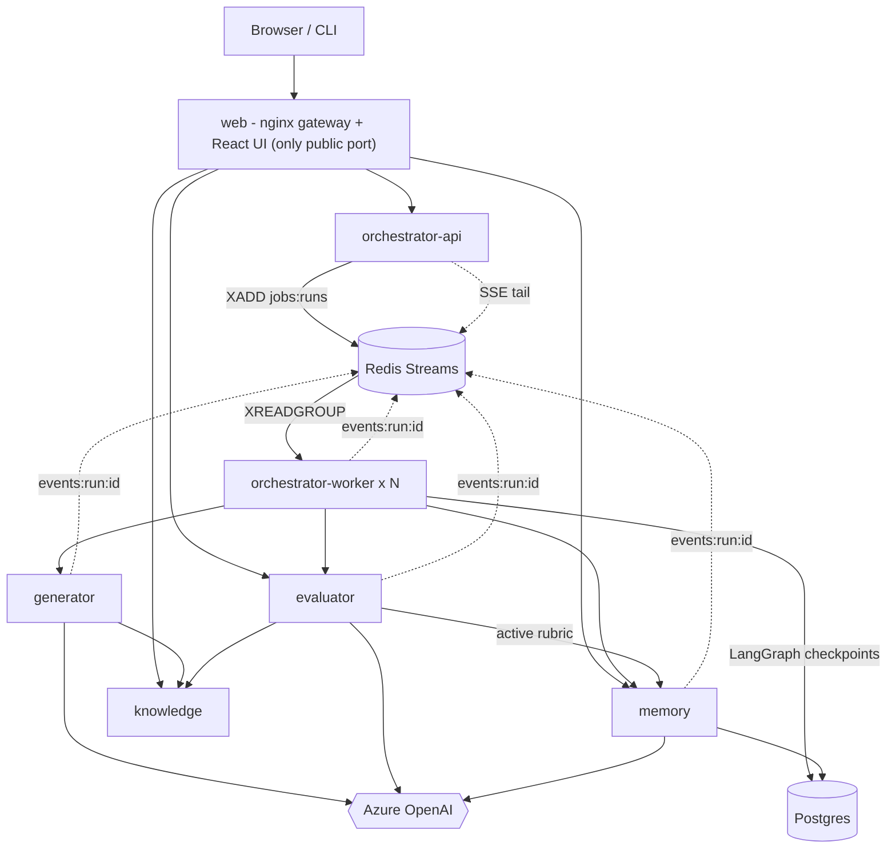
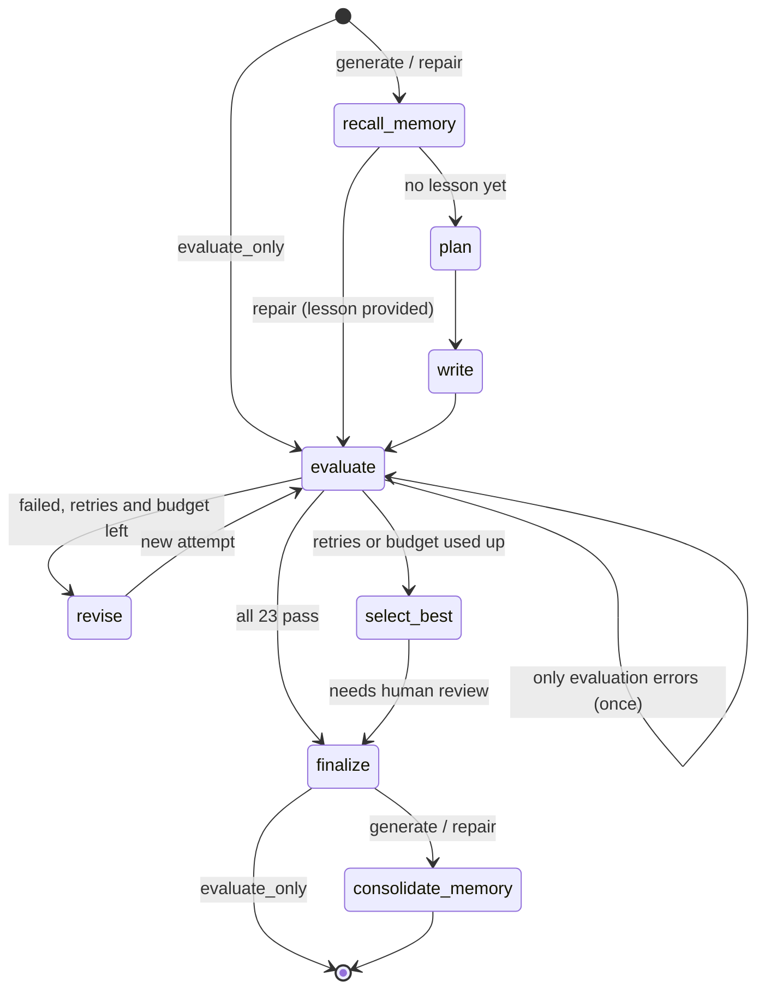

# Architecture and design decisions

This document explains **how the system is built and why**: the constraints, the shape of
the agentic loop, how the evaluator earns trust, how memory learns, and the trade-offs taken.

- [1. The problem, as constraints](#1-the-problem-as-constraints)
- [2. System overview](#2-system-overview)
- [3. The agentic loop](#3-the-agentic-loop)
- [4. The agents](#4-the-agents)
- [5. The evaluator](#5-the-evaluator)
- [6. Grounding: knowledge packs](#6-grounding-knowledge-packs)
- [7. Memory and self-evolution](#7-memory-and-self-evolution)
- [8. Models, effort and cost](#8-models-effort-and-cost)
- [9. Reliability and operations](#9-reliability-and-operations)
- [10. Observability and security](#10-observability-and-security)
- [11. Testing](#11-testing)
- [12. Trade-offs and alternatives](#12-trade-offs-and-alternatives)
- [13. What I would do next](#13-what-i-would-do-next)

---

## 1. The problem, as constraints

| From the brief | Constraint it puts on the design |
|---|---|
| Generate -> evaluate -> regenerate until good enough to ship | A **loop with a decision point**, owned by code, not left to a model's discretion. |
| Max 1-2 retries, so the loop always terminates | Termination must be **provable**: a hard retry counter (plus a cost budget and a recursion limit as backstops). |
| Hard pass/fail checkpoints, no partial credit | Every check returns exactly **PASS or FAIL**; the lesson ships only if **all** pass. |
| Accurate & grounded | Facts must be checked against something other than the writer's own model. |
| Beginner learner, limited English, non-English-medium | Language quality must be **measured**, not just judged; key words need a helper-language (Hindi) hint. |
| Output = lesson + rejection log | Every attempt, its verdicts, the evidence and what changed must be **persisted**. |
| Self-evolving, memory persists across runs, learns from feedback + logs | A durable memory with a **learning step** after each run, and a channel for human feedback. |
| Show the evaluator catching a deliberate error | First-class **fault injection** with expected outcomes. |

Design principles that follow from them:

1. **Deterministic control flow, agentic steps.** The loop is a state machine; agents do the
   open-ended work inside its nodes.
2. **The author is not the judge.** Writing and judging live in different services with
   different prompts and (by default) different models.
3. **Measure in code whatever can be measured in code.** Use LLM judges only for what needs
   judgment, and make them prove their verdicts.
4. **Grounded or refused.** Lessons are generated only for topics with a curated knowledge pack.
5. **Learn automatically, change the bar only with a human.**
6. **Everything observable.** Every step emits an event; every attempt is stored; every LLM
   call is costed.

## 2. System overview

| Service | Owns | Talks to |
|---|---|---|
| **orchestrator-api** | Run lifecycle: queue, cancel, resume, list, SSE stream, exports, system status | memory, knowledge, Redis |
| **orchestrator-worker** | The LangGraph pipeline (the agentic loop) and its checkpoints | generator, evaluator, memory, Redis, Postgres |
| **generator** | Planner and ReAct writer (create / revise). Internal only | knowledge, memory (rubric), Azure |
| **evaluator** | The rubric engine; deliberate-error presets | knowledge, memory (rubric), Azure |
| **knowledge** | Curated topic packs; search; glossary lookup | (Azure embeddings, optional) |
| **memory** | Runs, attempts, guidelines, feedback, rubric versions and proposals; consolidation | Postgres, Azure |
| **web** | UI + API gateway | everything public |

**Why microservices here (and why these boundaries).** Each boundary isolates something that
changes for a different reason or must stay independent:

- **Generator vs evaluator** - the core of the design. Separate services mean separate prompts,
  configuration, models, scaling and release cadence. The evaluator can be used on its own
  (Evaluator Lab, human-written lessons) and can never be "helped" by the writer's context.
- **Orchestrator** - owns only control flow, so the loop policy (retries, budget, escalation)
  lives in one place and is unit-tested as pure functions.
- **Knowledge** - the shared ground truth for the writer and the fact-checker; facts can be
  updated without redeploying either agent.
- **Memory** - the single owner of persistent learning state (database-per-service: its own
  logical database), with the learning step next to the data it reads and writes.
- **API / worker split** - LLM runs take minutes; they must not live in the API process. Workers
  scale horizontally (`docker compose up --scale orchestrator-worker=3`) and a crashed worker's
  job is resumed by another.

**Communication.** Commands are synchronous HTTP/JSON between services (typed clients in
`lessongen_common.clients`, Pydantic contracts in `lessongen_common.schemas`). Progress is
asynchronous: every service appends events to the run's Redis Stream, which the API tails for
Server-Sent Events. A single shared contracts library keeps the services honest: a contract
change breaks the tests, not production.

## 3. The agentic loop

Implemented in `services/orchestrator/src/orchestrator_svc/graph/`:

- **State** is a `TypedDict` of JSON-safe values (`state.py`), so checkpoints serialise safely
  and a run can resume in another process. Two reducers matter: `attempts` (the rejection log -
  append, but a re-evaluation of the same attempt replaces it) and `usage` (each node returns
  only the cost it caused; the reducer keeps the total).
- **Policy is pure** (`policy.py`): `route_after_evaluate`, `choose_strategy`, `select_best`,
  `section_diff`. They are table-tested and contain no I/O.

**Routing table.**

| Situation after an evaluation | Next | Why |
|---|---|---|
| All 23 checks pass | `finalize` -> **shipped** | The bar is cleared. |
| Only *errored* checks failed (e.g. an LLM timeout), first time | `evaluate` again | A crash is not a quality signal; rewriting a good lesson would be wrong and costly. |
| Evaluate-only (Lab) run | `finalize` -> **evaluated** | Report only. |
| Failures, retries left, budget left | `revise` | Feed reasons + fixes back. |
| Retries used up, or budget exhausted | `select_best` -> **needs human review** | Never ship a failing lesson; escalate the best attempt. |

**Termination guarantee.** Attempts are bounded by `max_retries + 1` (<= 3), evaluation
re-runs by `evaluation_error_retries` (1), cost by `RUN_BUDGET_USD`, and LangGraph's
`recursion_limit` is a final backstop. No path loops without consuming one of these.

**Patch vs rewrite.** If at most 6 checks failed, the writer *patches*: it gets the failed checks
(reason, evidence, fix) **and the list of checks that passed and must keep passing**, and changes
only what is needed. If more failed, it *rewrites* from the plan with all the feedback - small
edits rarely rescue a lesson that is wrong in many places. Every attempt is re-evaluated against
the **full** rubric, which catches regressions introduced by a fix.

**What changed.** Each attempt stores the writer's revision notes (one per failed check, enforced
by the submit tool) and a section-level diff computed in code. Together with the verdicts they
form the rejection log.

**Best attempt.** When retries run out, `select_best` picks the attempt with the fewest
*critical* failures, then the fewest failures, then the latest - the one a reviewer should start
from.

**Durability.** The worker compiles the graph with LangGraph's `AsyncPostgresSaver`
(`thread_id = run_id`). Every node boundary is a checkpoint, so a crash, a restart or a deploy
resumes the run at the failed node - plan and draft are not regenerated (tested in
`test_resumes_from_checkpoint_after_a_crash`). Side effects are idempotent: attempts are upserted
by `(run_id, attempt_no)`, run creation is idempotent by id.

**Cancellation** is a Redis flag checked by a wrapper before every node; the run stops at the next
node boundary and is marked cancelled. **Every node** is wrapped the same way: correlation ids
(run, attempt, node) are bound for logs, events and downstream HTTP headers, and
`node.started/completed` events carry duration, summary and cost.

## 4. The agents

### A small, explicit ReAct implementation

`lessongen_common/llm/react.py` builds a LangGraph subgraph:
`agent -> (tool calls) -> tools -> agent ... -> submit -> END`, with a `force_submit` node when the
step budget is spent. I chose this over the prebuilt `create_react_agent` for three guarantees
that matter in production:

1. **A typed final answer.** The agent finishes only by calling a `submit_*` tool whose arguments
   are validated by Pydantic *and* a business validator. A rejected submission returns the exact
   problems to the agent, which fixes them (self-correction) - so structural mistakes never reach
   the expensive evaluation.
2. **A hard step budget.** After `max_steps` model turns, the agent is made to produce a
   structured final answer from its research notes. The loop always ends and cost is bounded.
3. **Observable reasoning.** Every tool has a required `reason` argument. The UI shows each step
   as *Thought -> Action -> Observation* in real time - without relying on hidden reasoning tokens.

`tool_choice="required"` keeps the agent acting rather than chatting; several tools can run in
parallel per turn; tool failures become observations instead of crashing the agent.

### Writer (generator service)

| Tool | Purpose |
|---|---|
| `search_knowledge_base` | Grounding: every technical fact must come from the curated pack. |
| `lookup_glossary` | Approved simple meanings and reviewed Hindi hints, so terminology is consistent and the Hindi is correct. |
| `check_readability` | The **same metric code the evaluator uses** (`lessongen_common.textmetrics`), so the writer can self-check against the real yardstick. |
| `submit_lesson` / `submit_revision` | Typed output; rejects contract violations (missing/out-of-order sections, quiz shape, Hindi not in Devanagari, length) and, for revisions, missing notes for any failed check. |

The writer's system prompt contains the audience profile, writing rules, **the active rubric's
pass conditions** (the rubric is the spec - giving it to the writer is not cheating), learned
guidelines, frequently failing checks and human notes. It never sees the held-out learner
questions.

### Planner (generator service) - deliberately *not* an agent

Planning needs grounding but not exploration: the key points are known, so the planner does one
deterministic retrieval per key point and then a single structured call. Plan first, write second
separates *what to teach* (coverage, order, analogy, example) from *how to write it*; revisions
can fix the writing without re-deciding content. A plan that breaks the teaching order is sent
back once with the problems.

### Fact-checker (evaluator service)

Step 1 is a structured call that extracts the lesson's factual claims with their exact quotes
(excluding story props inside the worked example, analogies and quiz items). Step 2 is a ReAct
agent with `search_knowledge_base` and `submit_verdicts`; the submit tool **rejects any
submission that skips a claim** or gives a SUPPORTED/CONTRADICTED verdict without citing chunk
ids. Claims become ACC-1 (nothing contradicted) and ACC-2 (every number, date, name and statistic
supported).

### Simulated learner (evaluator service)

A cheap model role-plays the learner, reads only the lesson and answers six held-out questions
from the topic pack. Because a model cannot truly forget what it knows about AI, **every answer
must quote the lesson sentence that supports it**, and the quote is verified in code - an
unsupported answer counts as wrong. A separate grader compares answers with reference answers.
This turns "did the lesson teach it?" into a measurable check (COV-5).

## 5. The evaluator

23 binary checks across the six dimensions from the brief (details in [RUBRIC.md](RUBRIC.md)):

| Method | Checks | Why this method |
|---|---|---|
| Deterministic code | 9 | Readability, sentence length, rare vocabulary, length, glossary coverage of jargon, acronym expansion, Hindi script, teaching order, quiz shape - measurable, reproducible, free. |
| LLM judge | 11 | Judgment calls: correctness of Hindi hints, idioms and assumed knowledge, quality of the example and analogy, explaining terms at first use, coverage of what/why/how/limits, flow, quiz alignment. |
| Fact-check agent | 2 | Accuracy against the knowledge base. |
| Simulated learner | 1 | Does the lesson actually teach? |

It is a LangGraph graph too: `Send` fans out the deterministic batch, one judge call per LLM
check, the fact-check agent and the learner **in parallel**, then joins into one report stamped
with the rubric version. A process-wide semaphore bounds concurrent LLM calls to protect the
Azure quota.

**Making LLM judges trustworthy** - each known failure mode has a specific mitigation:

| Failure mode | Mitigation |
|---|---|
| Halo effect (a judge that likes the lesson passes everything) | **One check per call**, with explicit PASS-only-if and FAIL-if criteria. |
| Fabricated evidence | Judges must quote the lesson **verbatim**; quotes are verified in code (fuzzy match) and a fabricated quote triggers a re-judgment; unverifiable evidence is flagged in the UI. |
| Self-preference (the writer's model grading itself) | Judges run on a **different model** (GPT-5.4-mini) than the writer (GPT-5.5). |
| Noisy false FAILs that trigger needless rewrites | A FAIL needs a **second vote** (same family, more reasoning); a disagreement goes to a **third, stronger** model; majority wins. Votes are shown in the UI. |
| Vague criteria | Criteria are data in the rubric, filled with the topic's ground truth (`{how_steps}`, `{why_points}` ...) at evaluation time; reviewers can add clarifications through approved proposals. |
| Prompt injection inside the lesson | The lesson is delimited and declared data; judges are told to ignore instructions inside it. |
| A check that crashes | **Fail-safe**: it is reported as FAIL with `details.error`, so an unchecked lesson can never ship; the orchestrator re-evaluates once when only errors failed. |

**Cost-aware layout.** Every judge call is `[shared rules] + [lesson + topic reference] + [this
check]`. The long prefix is identical across the ~11 calls, so Azure's automatic prompt caching
applies to it.

**Measuring the evaluator.** `evals/run_evaluator_eval.py` injects every fault preset into the
reviewed reference lesson and reports detection rate, expected-check recall and the false-fail
rate on the clean lesson - an evaluator is a model and is evaluated like one.

**Deliberate errors.** Nine presets (factual error, invented statistic, unexplained jargon,
academic language, missing example, broken teaching order, wrong Hindi hint, wrong quiz key,
missing Hindi hints) each declare the checks that should catch them; the Lab and the CLI show
*expected vs caught*.

## 6. Grounding: knowledge packs

A topic pack (`services/knowledge/src/knowledge_svc/packs/rag/`) is the reviewed ground truth:

- `docs/*.md` - 11 short reference notes, each with a `source` (Lewis et al. 2020 for RAG's
  origin; Microsoft Learn and OpenAI documentation for concepts), chunked by heading.
- `glossary.yaml` - 27 approved terms with simple meanings and reviewed Hindi.
- `pack.yaml` - key points (what / why / how steps / misconceptions / limitations), what a worked
  example must show, the jargon watch-list, acronyms, and **six held-out learner questions**.

Packs are validated at startup (sources present, ids consistent, assessment present); a broken pack
fails readiness instead of silently producing ungrounded lessons. The held-out questions are only
returned with `include_assessment=true`, which only the evaluator requests - **the writer can never
teach to the test**.

**Retrieval** is stemmed BM25: deterministic, no extra deployment, and strong for a small curated
corpus. If an embeddings deployment is configured, a dense retriever is added and the rankings are
fused with Reciprocal Rank Fusion (hybrid search) - degrading to BM25 if embeddings fail. (Yes: the
system uses RAG to write lessons about RAG.)

**Unknown topics are refused** with a clear 422 listing the available packs. Generating lessons we
cannot fact-check would make ACC-1/ACC-2 meaningless.

## 7. Memory and self-evolution

**Data model** (memory service, Postgres, Alembic): `runs`, `attempts` (lesson, evaluation,
revision notes, diff - the rejection log), `guidelines` (text, linked checks, target agent, status,
counters, full version history), `feedback`, `rubric_versions`, `rubric_proposals`.

**Recall (start of a run).** The run receives the active guidelines for its topic ranked by
smoothed effectiveness `(helped + 1) / (helped + missed + 2)`, checks that failed on the first
attempt in >= 30% of recent runs, and unprocessed human comments. Applied guideline ids are stored
on the run so their effect can be measured.

**Consolidation (end of a run)** - `memory_svc/consolidation.py`:

1. **Effectiveness (code).** For every guideline injected into the run: did its linked checks pass
   on attempt 1? -> `helped`, otherwise `missed`.
2. **Reflection (LLM).** Failures, their evidence and *what fixed them* (from the next attempt's
   revision notes), plus human comments, become at most three new short, imperative, reusable
   guidelines linked to check ids - or **sharpen** an existing guideline whose check failed again.
   Near-duplicates are merged; unknown check ids are dropped. A run that passed first time costs no
   LLM call.
3. **Guardrails (code).** Guidelines that missed 3 times without ever helping are retired; the
   active set per topic is capped (lowest effectiveness retired first).
4. **Escalation.** A check that keeps failing on the first attempt despite guidelines (>= 3 of the
   last 5 runs) becomes a proposal for a human: the fix probably belongs in the template or the
   rubric, not in another guideline.
5. **Human feedback.** Comments become guidelines; "the evaluator was wrong on check X" becomes a
   **rubric clarification proposal** drafted by the LLM.

**The guardrail that matters most:** the writer's guidelines evolve automatically, but **the rubric
never changes without a human approving a proposal** - which creates a new rubric version, stamped
on every later report. The system can make the writer better on its own; it cannot make the exam
easier on its own.

**What learning looks like.** The Memory page plots *checks failed on the first attempt, per run*
and per-check first-attempt failure rates; every guideline shows applied / helped / missed and its
edit history.

## 8. Models, effort and cost

Two Azure deployments, eight roles (`lessongen_common/llm/config.py`):

| Role | Default model | Reasoning effort | Why |
|---|---|---|---|
| planner | GPT-5.5 | low | Outline quality, one call. |
| writer | GPT-5.5 | medium | The product. Best writing and tool use. |
| judge | GPT-5.4-mini | low | Different model from the writer; ~6x cheaper; ~11 calls per attempt. |
| judge_confirm | GPT-5.4-mini | medium | A more careful second look before accepting a FAIL. |
| judge_tiebreak | GPT-5.5 | low | Strongest model breaks disagreements. |
| fact_checker | GPT-5.4-mini | medium | Evidence-based against retrieved text; switch to GPT-5.5 with one env var if the eval shows misses. |
| learner | GPT-5.4-mini | none | A fast, shallow reader is closer to a beginner. |
| reflector | GPT-5.5 | medium | Its guidelines steer every future run. |

GPT-5-family models are reasoning models: `temperature` is not used; `reasoning_effort` and strict
binary criteria are the levers. Any role can be moved to another deployment, tier or effort through
environment variables. Every call's token usage (including cached and reasoning tokens) is priced by
the served model name and rolled up per node, per attempt and per run; a run typically costs
$1-2 and `RUN_BUDGET_USD` caps it. GPT-4o was deliberately not used: Azure retired the 2024-11-20
Standard deployments in October 2026.

## 9. Reliability and operations

| Concern | What the system does |
|---|---|
| Transient failures between services | Retries only when the request certainly did not run (connection errors) or the upstream said "try again" (502/503/504). **Read timeouts are not retried** - the LLM call may still be running and repeating it would double the cost. |
| Azure throttling | The OpenAI client retries 429 with backoff; a semaphore bounds concurrent calls per process. |
| Malformed model output | Structured outputs (`json_schema`); on a validation error the error is shown to the model for one more try; agents self-correct through rejected submissions. |
| Missing credentials | HTTP 424 with a clear message, never retried. |
| Worker crash mid-run | The job stays pending (acked only at a terminal state); another worker reclaims it (`XAUTOCLAIM`) once its TTL lock has expired, and LangGraph resumes from the last checkpoint. |
| Two workers, one job | A lock with a heartbeat (`lock:run:<id>`); a reclaimer skips jobs whose owner is alive. |
| Failed run | Status `failed` with the error; *Resume* re-queues it from the checkpoint once the cause is fixed. |
| Deploys / restarts | Graceful SIGTERM: the worker stops reading jobs and drains running ones; compose `stop_grace_period`. |
| Startup ordering | Readiness probes check real dependencies (database, Redis, packs); `depends_on: service_healthy`; migrations run as a one-shot job before the memory service starts. |
| Runaway cost | Retry cap, budget cap, step budgets in every agent, bounded concurrency. |

## 10. Observability and security

**Observability.**
- One event stream per run (`events:run:<id>`) receives events from every service; the UI and the
  CLI render them live, and they can be replayed from any id (browser reconnects lose nothing).
- Structured JSON logs (structlog) on every line carry `service`, `request_id`, `run_id`,
  `attempt` and `node`, propagated across services via headers.
- Per-call cost accounting by model; per-node duration and cost in the events.
- Optional LangSmith tracing (`LANGSMITH_TRACING=true`) captures every LangGraph/LangChain step.
- `/healthz` (liveness) and `/readyz` (dependencies) on every service; the System page and
  `GET /v1/system/status` aggregate them with queue depth and the role -> model map.

**Security.**
- Secrets live only in `.env` (git-ignored), are `SecretStr` in code, never logged and never sent
  to the browser.
- Only the gateway publishes a port, bound to localhost by default; the generator has no public
  route at all; unknown API paths return a JSON 404.
- Containers run as non-root; the gateway is `nginx-unprivileged` with CSP, `nosniff`,
  frame-deny and referrer headers.
- Run creation is rate-limited (it spends money); request sizes and field lengths are bounded.
- Untrusted text (topics, lessons in the Lab, feedback, retrieved text) is delimited and declared
  data in prompts; Markdown is rendered without raw HTML.
- Production would add authentication at the gateway, TLS, managed secrets and network policies.

## 11. Testing

- **131 backend tests**, all offline: every LLM is a scripted fake (`lessongen_common.testing`),
  including tool-calling turns, structured outputs and failures. They cover the ReAct loop
  (research, self-correction, forced submission), judge voting and evidence re-judging, the
  fact-checker rejecting skipped claims, the learner's quote verification, every deterministic
  check (reference lesson passes; faults fail), the loop policy as a table, the full LangGraph
  pipeline in every mode (ship first time, patch then ship, rewrite, escalate after max retries,
  budget cap, errors-only re-evaluation, cancellation, **resume from checkpoint**), the Redis job
  queue and lock/reclaim logic, SSE replay, Alembic migrations matching the models, and the
  memory consolidation with its guardrails.
- **Frontend:** strict TypeScript, Vitest for the SSE reducer and chart scales.
- **CI** (`.github/workflows/ci.yml`): lint + tests, frontend typecheck/test/build, Docker builds.
- **Evaluator meta-evaluation** against real models: `evals/run_evaluator_eval.py`.

## 12. Trade-offs and alternatives

| Decision | Alternative considered | Why this way |
|---|---|---|
| LangGraph state machine for the loop | One ReAct "manager" agent deciding when to retry | Termination and policy must be guaranteed and testable; an agent can loop or give up arbitrarily. |
| Custom ReAct subgraph | `create_react_agent` / `create_agent` | Typed submit with business validation, hard step budget with forced answer, `reason` on every tool for live observability. ~250 lines, fully tested. |
| One judge call per check | One call judging all checks | Avoids the halo effect and gives per-check evidence; cost controlled with a cheaper model and prompt caching. |
| Deterministic metrics for language | LLM judge for readability | Reproducible, free, explainable thresholds; the writer can use the same code. |
| Zipf word frequency for vocabulary | Dale-Chall easy-word list | Dale-Chall (US 4th grade) flags words Indian 12th graders know ("computer", "example", "exam"); frequency plus an academic-words list and an India-familiar list fits the learner. |
| Curated knowledge pack + refuse unknown topics | Web search / model knowledge | Facts must be checkable; refusing is safer than shipping unverifiable content. |
| BM25 by default | Vector database | Right-sized for a 58-chunk curated corpus, deterministic and free; hybrid is one env var away; pgvector is the scale-up path. |
| Redis Streams job queue | Celery / a hosted queue | Already needed for events; consumer groups give at-least-once delivery, reclaiming and replay with ~100 lines and no new dependency. |
| Postgres checkpoints | In-memory or SQLite | Durable resume across processes and machines. |
| Patch vs rewrite threshold | Always regenerate from scratch | Patching keeps what passed (and its cost); rewriting rescues lessons that are wrong in many places. |
| Automatic guideline learning, human-approved rubric changes | Fully automatic rubric tuning | Prevents the system from lowering its own bar. |
| Microservices | A modular monolith | Requested, and justified by the author/judge separation and the long-running workload; the price is more moving parts, which compose, health checks and typed contracts keep manageable. |

## 13. What I would do next

- **New topics:** an LLM-bootstrapped "ungrounded" pack mode whose runs always end in human
  review, plus an editor flow to promote a reviewed pack.
- **Evaluator calibration loop:** run the meta-evaluation in CI on a schedule with a small budget;
  alert when detection drops.
- **A/B guideline evaluation:** occasionally withhold a guideline to measure its causal effect
  instead of relying on before/after counts.
- **Scale-out:** managed Postgres/Redis, horizontal workers with autoscaling on queue depth,
  pgvector for large packs, OpenTelemetry traces across services.
- **Auth and multi-tenancy** at the gateway; per-team budgets.
